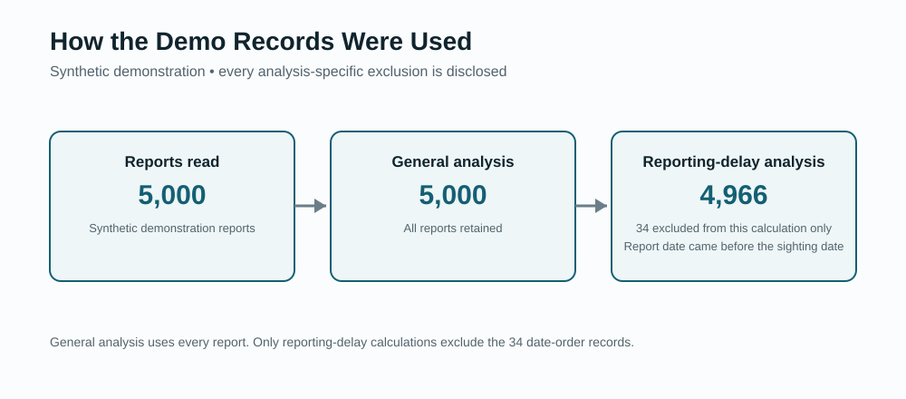

# UFO/UAP Sightings Quantitative Analysis

> A reproducible Python pipeline for cleaning, validating, visualizing, and statistically analyzing reported UFO/UAP sighting datasets.

```bash
python -m sightings_analysis demo
```

No external dataset, scraping, API key, account, or personal information is required for the demonstration. Use **GitHub Codespaces** for a zero-local-setup experience, or Python 3.11+ for local execution.

The pipeline:

- validates temporal and U.S. state-coded data before analysis,
- generates exploratory figures and structured statistical outputs,
- records sample sizes, quality flags, exclusions, zero-report months, and methodology limits.



This project analyzes patterns in **reported records**. It does not verify underlying events or establish causal relationships.

## Start Here

### Zero local setup with Codespaces

1. Open this repository on GitHub.
2. Select **Code → Codespaces → Create codespace on main**.
3. Run:

```bash
python -m sightings_analysis demo
```

The development container installs the package and opens at the repository root.

### Local demonstration

From the repository directory:

```bash
python -m sightings_analysis demo
```

The demo creates and analyzes 5,000 deterministic synthetic reports inside `reports/demo/`. It never writes into the installed package directory.

### See every command

```bash
python -m sightings_analysis --help
```

## What the Demo Creates

```text
reports/demo/
├── input/
│   └── synthetic-reports.csv
├── analysis-summary.md
├── data-quality-report.json
├── descriptive-statistics.json
├── statistical-results.csv
├── run-manifest.json
├── sample-flow.csv
└── figures/
    ├── reports-by-year.svg
    ├── reports-by-month.svg
    ├── reports-by-time-of-day.svg
    ├── reports-by-state.svg
    ├── reports-by-shape.svg
    └── sample-flow.svg
```

The command reports how many records were analyzed, how many quality findings occurred, and exactly where the outputs were saved.

## Bring Authorized Data

The v1 workflow supports UTF-8 CSV files with five fields and two-letter U.S. state or DC codes.

Create a ready-to-edit template and field guide:

```bash
python -m sightings_analysis template \
  --output my-reports-template.csv
```

Validate a CSV without modifying it:

```bash
python -m sightings_analysis validate \
  --reports my-reports.csv
```

Use `--json` for complete machine-readable terminal output:

```bash
python -m sightings_analysis validate \
  --reports my-reports.csv \
  --json
```

Analyze it after reviewing the validation results:

```bash
python -m sightings_analysis analyze \
  --reports my-reports.csv \
  --output reports/my-analysis
```

When material calendar-order warnings exist, acknowledge them explicitly:

```bash
python -m sightings_analysis analyze \
  --reports my-reports.csv \
  --output reports/my-analysis \
  --allow-warnings
```

The schema is documented in [`docs/data-schema.md`](docs/data-schema.md). The tool requires `--force` before replacing existing output and never modifies the source CSV.

## Why This Repository Exists

The project began as a December 2024 quantitative-analysis final project. The original workflow automated data preparation, temporal feature engineering, exploratory visualization, hypothesis testing, correlation, regression, and written findings.

A later methodology V&V review identified material issues involving date semantics, geographic identifier matching, hidden sample attrition, outlier treatment, and hypothesis design. This version preserves the original analytical achievement while correcting those weaknesses and encoding the lessons into tests, validation controls, complete monthly sequences, and transparent sample-flow reporting.

Read the project evolution:

- [`case-study/original-project.md`](case-study/original-project.md)
- [`case-study/methodology-audit.md`](case-study/methodology-audit.md)
- [`case-study/lessons-and-evolution.md`](case-study/lessons-and-evolution.md)

## Example Outputs

| Figure | Purpose |
|---|---|
| [Reports by year](reports/example/figures/reports-by-year.svg) | Demonstrates complete-period temporal counts |
| [Reports by month](reports/example/figures/reports-by-month.svg) | Shows calendar-month distribution across the synthetic sample |
| [Reports by time of day](reports/example/figures/reports-by-time-of-day.svg) | Demonstrates derived temporal categories |
| [Reports by state](reports/example/figures/reports-by-state.svg) | Preserves the project’s geographic-analysis identity |
| [Reports by shape](reports/example/figures/reports-by-shape.svg) | Shows standardized reported-shape categories |
| [Sample flow](reports/example/figures/sample-flow.svg) | Makes analysis-specific exclusions visible |

The complete committed example is available in [`reports/example/`](reports/example/).

## Current Scope

This v1 release is a first-pass **U.S. sighting-report validation, descriptive-analysis, and temporal-statistics pipeline**.

It does not yet provide military-base or nuclear-facility comparisons, population-adjusted rates, proximity analysis, international geography, or text analysis. Those original research questions are preserved in the case study but are not presented as validated headline findings.

## Public Data Boundary

This repository contains only deterministic synthetic report data and safe example outputs. It does not contain scraped reports, witness narratives, original course submissions, personal logs, or third-party raw datasets.

Users are responsible for ensuring they are authorized to access and analyze their own datasets. Automated public-boundary checks support—but do not replace—human review.

## Methodology Principles

- Compare calendar dates when one field is date-only.
- Standardize geographic identifiers before joining datasets.
- Measure and disclose join coverage.
- Retain quality flags instead of silently deleting records.
- Preserve zero-report months in temporal sequences.
- Scope exclusions to the analysis that requires them.
- Mark unsupported statistics as not calculated instead of crashing.
- Align every statistical test with the research question.
- Distinguish reproducibility from validity.
- Describe associations without claiming causation.

See [`docs/methodology.md`](docs/methodology.md) and [`docs/responsible-interpretation.md`](docs/responsible-interpretation.md).

## Development and Release Controls

Run the complete test suite:

```bash
python -m unittest discover -s tests -v
```

Run the public-boundary scan:

```bash
python -m sightings_analysis privacy-scan .
```

Verify the release manifest:

```bash
python -m sightings_analysis verify-release
```

After intentionally changing release files, regenerate the manifest:

```bash
python -m sightings_analysis build-release-manifest --force
```

See [`RELEASE_PROCESS.md`](RELEASE_PROCESS.md) and [`release-validation-report.md`](release-validation-report.md).

## Roadmap

The focused roadmap includes population-adjusted rates, sensitivity analysis, configurable comparison periods, geospatial distance methods, county-level aggregation, contextual event comparisons, and interactive exploration. See [`docs/roadmap.md`](docs/roadmap.md).

## License

MIT. See [`LICENSE`](LICENSE).
