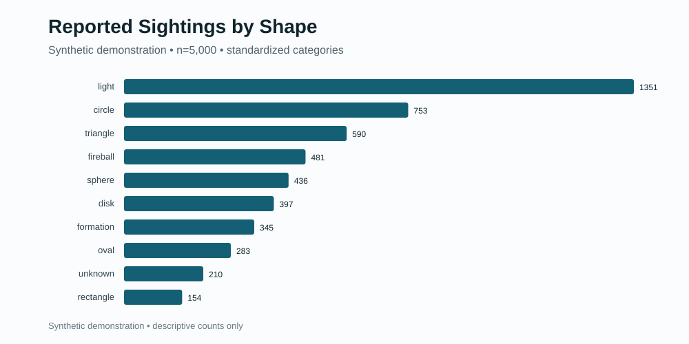

# UFO/UAP Sightings Quantitative Analysis

> Explore patterns in reported UFO/UAP sightings through a transparent, repeatable data-analysis experience.

UAP is a newer term commonly used alongside UFO. This repository studies **reported records**. It does not verify underlying events or establish causal relationships.

[](https://github.com/LuckyGitHub777/ufo-uap-sightings-analysis/actions/workflows/ci.yml)
[](https://github.com/LuckyGitHub777/ufo-uap-sightings-analysis/actions/workflows/public-boundary.yml)
[](https://codespaces.new/LuckyGitHub777/ufo-uap-sightings-analysis)

## The Story

This project began as a quantitative-analysis final project built around a large real-world sighting-report dataset. The first version automated data preparation, exploratory visualizations, statistical comparisons, correlation, regression, and written findings.

A later verification and validation review found that reproducible code can still produce misleading results when date meanings, geographic identifiers, exclusions, or statistical tests do not match the question being asked.

Rather than hide those limitations, the project was rebuilt around explicit validation, visible record accounting, regression tests, synthetic demonstration data, safer statistical behavior, and clear interpretation boundaries. The result is a reusable analysis tool and a documented example of how analytical work can improve through critical review.

## Evidence Status

| Evidence class | Current status |
|---|---|
| Software behavior | Tested through unit, deterministic, privacy, manifest, and installed-wheel controls |
| Synthetic demonstration | Reproducible and safe to explore |
| Data-quality controls | Visible and regression-tested |
| Real-world sighting conclusions | Not claimed |
| Event verification | Not performed |
| Causal interpretation | Not supported |
| Future geographic research | Preserved as planned work, not validated findings |

## See the Experience



*Example output generated from synthetic demonstration data. It shows the software’s reporting experience, not real-world UFO/UAP findings.*

**Prefer to look around first?** Open the curated [example experience](reports/example/README.md), then explore the [analysis summary](reports/example/analysis-summary.md) and [figures](reports/example/figures/) without running anything.

## Try the Demonstration

The easiest path is the **Open in GitHub Codespaces** badge above. Codespaces opens a ready-to-run workspace in your browser, so nothing needs to be installed locally.

After the workspace finishes loading, enter this command in the terminal:

```bash
python -m sightings_analysis demo
```

The demo creates 5,000 generated example records. It does not download, publish, or analyze real witness reports. No external dataset, scraping, API key, account, or personal information is required.

### What happens next

1. The tool creates the demonstration records.
2. It validates the data and explains any quality findings.
3. It generates charts and statistical results.
4. It records the files and hashes needed for reproducibility.
5. It tells you exactly where the results were saved.

### Open this first

```text
reports/demo/analysis-summary.md
```

This human-readable report explains what the data represents, what the demonstration shows, what the statistics mean, and what the results do not establish.

The other primary destinations are:

- `reports/demo/figures/`: visual results
- `reports/demo/data-quality-report.json`: complete validation evidence
- `reports/demo/run-manifest.json`: reproducibility and output hashes

<details>
<summary>See the complete demonstration output</summary>

```text
reports/demo/
├── input/
│   └── synthetic-reports.csv
├── analysis-summary.md
├── data-quality-report.json
├── descriptive-statistics.json
├── statistical-results.csv
├── run-manifest.json
├── sample-flow.csv
└── figures/
    ├── reports-by-year.svg
    ├── reports-by-month.svg
    ├── reports-by-time-of-day.svg
    ├── reports-by-state.svg
    ├── reports-by-shape.svg
    └── sample-flow.svg
```

</details>

## Choose Your Path

### Explore in the browser

Use Codespaces when you want a guided browser workspace with no local installation.

### Run locally

Requires Python 3.11 or newer:

```bash
git clone https://github.com/LuckyGitHub777/ufo-uap-sightings-analysis.git
cd ufo-uap-sightings-analysis
python -m sightings_analysis demo
```

A release ZIP may also be downloaded and extracted. Open a terminal in the extracted repository folder and run the same demo command.

### See every command

```bash
python -m sightings_analysis --help
```

## What the Review Changed

Three examples capture the main lessons:

- **Dates:** compare date-only fields as calendar dates, not midnight timestamps.
- **Geography:** standardize identifiers before joining datasets.
- **Statistics:** use tests that answer the research question actually being asked.

The review also made exclusions visible, retained zero-report months, added controlled sparse-data behavior, and converted methodology defects into regression tests.

Read the complete project record:

- [`case-study/original-project.md`](case-study/original-project.md)
- [`case-study/methodology-audit.md`](case-study/methodology-audit.md)
- [`case-study/lessons-and-evolution.md`](case-study/lessons-and-evolution.md)

### What this project demonstrates

- Preparing and validating structured data before analysis
- Producing descriptive statistics and exploratory visualizations
- Selecting statistical methods that match the research question
- Recording sample sizes, exclusions, and data-quality limitations
- Distinguishing reproducibility from analytical validity
- Communicating findings without overstating the evidence
- Converting an analysis into tested, reusable software

## Analyze Authorized Data

Version 1 expects a prepared UTF-8 CSV with five fields and two-letter U.S. state or DC codes. It does not automatically convert an arbitrary dataset into the required schema.

Example:

```csv
report_id,occurred_at,reported_date,state,shape
EXAMPLE-001,2024-06-15T21:30,2024-06-16,CA,light
```

Before validation:

- rename columns to the documented names,
- convert state names to two-letter codes,
- format dates as shown,
- remove narrative, contact, coordinate, and direct-link columns,
- retain one unique `report_id` per row.

Create a ready-to-edit template and field guide:

```bash
python -m sightings_analysis template \
  --output my-reports-template.csv
```

Validate a CSV without modifying it:

```bash
python -m sightings_analysis validate \
  --reports my-reports.csv
```

Use `--json` for complete machine-readable terminal output:

```bash
python -m sightings_analysis validate \
  --reports my-reports.csv \
  --json
```

Analyze the data after reviewing the validation results:

```bash
python -m sightings_analysis analyze \
  --reports my-reports.csv \
  --output reports/my-analysis
```

A **date-order warning** means the report date is earlier than the reported sighting date. When material warnings exist, review them and continue explicitly only when appropriate:

```bash
python -m sightings_analysis analyze \
  --reports my-reports.csv \
  --output reports/my-analysis \
  --allow-warnings
```

The tool requires `--force` before replacing existing output and never modifies the source CSV.

See [`docs/data-schema.md`](docs/data-schema.md) and [`docs/bring-your-own-data.md`](docs/bring-your-own-data.md).

## Data Quality and Record Use


All 5,000 generated reports remain part of the general analysis. Thirty-four records have a report date earlier than the sighting date. Those records remain visible in the quality report but are excluded only from reporting-delay calculations, which therefore use 4,966 records.

The generated dataset includes these date-order cases so the demonstration can show how the validation and sample-accounting controls handle them.

The machine-readable [`sample-flow.csv`](reports/example/sample-flow.csv) records every analysis-specific exclusion and its reason.

## Understand the Results

The generated summary is intentionally ordered for people:

1. a concise overview,
2. a plain-language explanation,
3. data-quality and coverage details,
4. detailed statistics,
5. a short glossary,
6. clear interpretation limits,
7. the files created.

The figures demonstrate the reporting experience:

| Figure | Purpose |
|---|---|
| [Reports by year](reports/example/figures/reports-by-year.svg) | Demonstrates complete-period temporal counts |
| [Reports by month](reports/example/figures/reports-by-month.svg) | Shows calendar-month distribution |
| [Reports by time of day](reports/example/figures/reports-by-time-of-day.svg) | Demonstrates derived temporal categories |
| [Reports by state](reports/example/figures/reports-by-state.svg) | Preserves the project’s geographic-analysis identity |
| [Reports by shape](reports/example/figures/reports-by-shape.svg) | Shows standardized reported-shape categories |
| [Record use](reports/example/figures/sample-flow.svg) | Makes analysis-specific exclusions visible |

## Scope and Responsible Interpretation

This release is a first-pass **U.S. sighting-report validation, descriptive-analysis, and temporal-statistics pipeline**.

It does not provide military-base or nuclear-facility comparisons, population-adjusted rates, proximity analysis, international geography, or text analysis. Those historical research questions are preserved in the case study but are not presented as validated findings.

Core interpretation rules:

- Report counts are not verified physical events.
- Correlation does not establish causation.
- State-level counts do not establish proximity.
- Synthetic results do not describe the real world.
- User-data results remain limited by source-data quality.

See [`docs/methodology.md`](docs/methodology.md) and [`docs/responsible-interpretation.md`](docs/responsible-interpretation.md).

## Public Data Boundary

This repository contains deterministic synthetic report data and safe example outputs. It does not contain scraped reports, witness narratives, original course submissions, personal logs, or third-party raw datasets.

Users are responsible for ensuring they are authorized to access and analyze their own datasets. Automated public-boundary checks support, but do not replace, human review.

## Contributing and Security

See [`CONTRIBUTING.md`](CONTRIBUTING.md) for contribution rules and privacy-safe issue guidance.

Report vulnerabilities privately as described in [`SECURITY.md`](SECURITY.md). Do not disclose vulnerability details, credentials, personal data, or restricted datasets through public issues or pull requests.

## Development and Release Controls

```bash
python -m unittest discover -s tests -v
python -m sightings_analysis privacy-scan .
python -m sightings_analysis verify-release
```

After intentionally changing controlled release files:

```bash
python -m sightings_analysis build-release-manifest --force
python -m sightings_analysis verify-release
```

See [`docs/experience-contract.md`](docs/experience-contract.md), [`RELEASE_PROCESS.md`](RELEASE_PROCESS.md), and [`release-validation-report.md`](release-validation-report.md).

## Roadmap

The focused roadmap includes population-adjusted rates, sensitivity analysis, configurable comparison periods, geospatial distance methods, county-level aggregation, contextual event comparisons, and interactive exploration. See [`docs/roadmap.md`](docs/roadmap.md).

## License

MIT. See [`LICENSE`](LICENSE).
